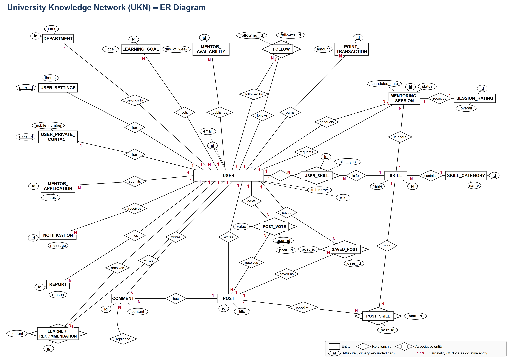
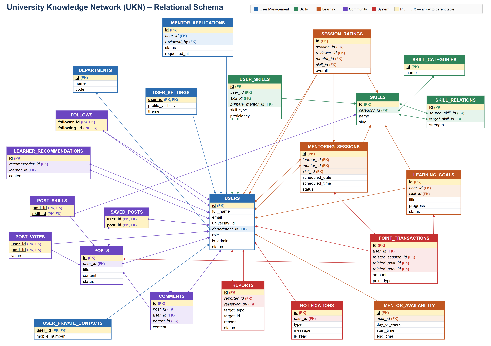

# University Knowledge Network (UKN)
## DBMS Project Report

**Project Report**
**Course:** Database Management System (DBMS)

**Group Number:** ______
**Group Members:** ______

---

## Project Understanding Summary

*(Prepared from inspection of the source code, `database/schema.sql`, the seed files, the patches and the backend/frontend pages. Every statement in this report was checked against the code, not taken from a template.)*

| Item | Finding |
|---|---|
| **Technology stack** | PHP 8 (developed on 8.2), server-rendered pages; HTML5, CSS3, Bootstrap 5.3, vanilla JavaScript; Chart.js 4 (admin dashboard); PHPMailer 6.12 (SMTP, with a file-log mail transport for development); Apache (XAMPP) with `.htaccess` rules. No build step and no package manager. |
| **Architecture** | Front-controller pattern. `index.php?page=<route>` whitelists 36 routes, applies route guards (guest / logged-in / learner / mentor / admin) and renders a page template from `pages/`. State-changing actions are plain HTML forms that `POST` to a script under `backend/` (58 action scripts), which validates, runs a database transaction and redirects with a flash message. Shared logic is in `backend/helpers/`; reusable UI in `components/`, `modals/`, `includes/`. The admin panel is a separate area under `admin/` with its own layout and its own action scripts under `backend/admin/`. |
| **Database system** | MySQL / MariaDB (developed and tested on MariaDB 10.4), InnoDB, `utf8mb4_unicode_ci`, accessed through PDO with prepared statements and `STRICT_TRANS_TABLES`. |
| **Main modules** | Authentication and account security · Profiles · Skills (categories, skills, learning/teaching skills) · Mentor application and approval · Mentor availability · Mentor recommendation engine · Learning goals · Mentoring sessions (request → accept → complete → rate) · Points ledger and leaderboard · Community (posts, comments, votes, saves, follows, reports) · Learner recommendations · Notifications · Global search · Admin panel. |
| **Number of tables** | **24 base tables + 1 view** (`mentor_rating_summary`). |
| **Constraints** | 42 foreign keys, 27 named `CHECK` constraints, many `UNIQUE` keys, one `FULLTEXT` index, and one generated (persistent) column. |
| **Important relationships** | `users` is the hub of the schema. `users ← user_skills → skills` (M:N, typed `learning`/`teaching`); `mentoring_sessions` links a **learner (users)**, a **mentor (users)** and a **skill** (three FKs); `session_ratings` is 1:1 with a completed session; `posts → comments` (with a self-reference `parent_id` for replies); `post_votes`, `saved_posts`, `follows` (M:N junction tables); `point_transactions` is the points ledger referencing users and optionally a session, post or goal; `reports` points to a post/comment/user through a polymorphic `target_type + target_id` (the only relationship without an FK). |
| **Features that appear in the report template but are not implemented** | *Solutions* (marking a comment as the accepted solution of a post) does not exist; there is no real-time chat or video. See Section 13. |

---

# 1. Group Details

**Project Name:** University Knowledge Network (UKN)

**Group Number:** ______

**Member Details:**

| Name | Student ID | Contribution |
|---|---|---|
| ______ | ______ | ______ |
| ______ | ______ | ______ |
| ______ | ______ | ______ |
| ______ | ______ | ______ |

> The repository does not record member names or individual contributions (all 16 commits are under a single account), so this table must be completed by the group.

---

# 2. Video Demonstration Link

**Video Link:** ______

---

# 3. Introduction

The **University Knowledge Network (UKN)** is a database-driven web platform for peer learning and mentoring inside a university. Students list the skills they want to learn, find other students who can teach them, book one-to-one mentoring sessions, rate the experience, and share knowledge in a community feed. A points system and a leaderboard make helpful participation visible, and an administration panel keeps the platform's content and membership under control.

**Problem it solves.** University students already hold a large amount of practical knowledge (programming, data analysis, design, academic writing, presentation skills), but there is no organised way to discover who knows what, to ask for help from a fellow student, or to record that help was given. Knowledge stays inside friend groups and informal chats, and learners cannot judge whether a would-be helper is reliable.

**Database-driven architecture.** UKN is built around a normalised relational schema of 24 tables in MySQL/MariaDB. All business rules that can be expressed declaratively are enforced inside the database (foreign keys, unique keys, `CHECK` constraints, `ENUM` domains, a generated column that enforces "one pending mentor application per user", and a view for mentor ratings). Every multi-step write — registration, session completion with points, rating, voting, moderation — runs inside a single ACID transaction, with row locking (`SELECT … FOR UPDATE`) where concurrent requests could conflict. The PHP application is a thin layer over this schema; leaderboards, recommendations and search are computed by SQL aggregate queries over the stored data.

**Users and interactions.**

- **Learner** – every new account. Chooses learning skills, sets goals, receives mentor recommendations, requests sessions, rates completed sessions, posts and comments in the community, and can apply to become a mentor.
- **Learner & Mentor** (`users.role = 'dual'`) – an account whose mentor application was approved by an admin. It keeps all learner abilities and can switch to *Mentor mode* to list teaching skills, publish weekly availability, accept or reject session requests and complete sessions.
- **Admin** (`users.is_admin = 1`) – a separate flag, independent of learner/mentor capability. Admins manage departments, skill categories, skills, users, mentor applications, posts, comments and reports.
- **Guest** – can browse the feed, skills, public profiles, post details and search results.

**Main purpose.** To turn the scattered knowledge of a student body into a structured, searchable, trusted and gamified knowledge network, and to demonstrate sound relational database design, SQL feature use and transactional integrity in a realistic application.

---

# 4. Motivation

University learning does not end in the classroom. Students constantly look for someone who can explain a topic in the way a peer would — a senior who has already taken the course, a classmate who is strong at SQL, a student from another department who knows UI design. Several gaps motivated UKN:

1. **Skill sharing is informal and invisible.** A student who is good at Python has no place to say so, and a student who needs Python help has no place to look. UKN gives both sides a structured profile: *teaching skills* and *learning skills*, each with a proficiency level.
2. **Peer learning is effective but unmanaged.** Peers explain concepts at the learner's level, but nothing records requests, schedules, outcomes or feedback. UKN models the whole life cycle of a session (`pending → accepted → completed`, or `rejected` / `cancelled`) with timestamps, and lets the learner rate it.
3. **The mentorship gap.** Faculty advising is limited, and senior-to-junior mentoring depends on personal contacts. UKN lets any student apply to become a mentor, has an admin vet the application, and then lets learners find mentors through search, filters and a scored recommendation.
4. **Trust and motivation.** Without feedback, a learner cannot tell a good mentor from a poor one, and mentors have no incentive to keep helping. UKN stores multi-dimensional ratings (overall, teaching, communication, helpfulness) and a point ledger that rewards completed sessions and penalises late cancellations, then ranks members on a leaderboard.
5. **Knowledge management.** Questions answered in private chats are lost. The community feed with tagged posts, threaded comments, voting, saving, and full-text search keeps knowledge searchable and reusable by the next student.
6. **A database course objective.** The domain is rich enough to need many-to-many relationships, self-references, a polymorphic reference, aggregate analytics, derived data, concurrency control and a reporting view — a realistic vehicle for applying the DBMS concepts taught in the course.

---

# 5. Similar Projects

## 5.1 LinkedIn Learning

- **Purpose.** A subscription library of professionally produced video courses aimed at career and workplace skills, linked to the LinkedIn professional profile.
- **Limitations.** Content is one-directional (instructor to learner); there is no scheduled one-to-one peer help; learners cannot ask a classmate a question in the context of their own course; it is not tied to a particular university's departments or courses; and access is paid.
- **How UKN differs.** UKN is peer-to-peer and bidirectional — every learner can also become a mentor. Mentoring sessions are scheduled between two students of the same university, and ratings and points describe real help that was given to a real peer.

## 5.2 Coursera

- **Purpose.** A platform that hosts structured university and industry courses with assignments, quizzes and certificates (MOOC model).
- **Limitations.** Courses follow a fixed syllabus and a fixed schedule; interaction is mostly through forums with thousands of participants; there is no matching with a mentor who teaches a specific skill at a time suitable for the learner; and it is not specific to one campus.
- **How UKN differs.** UKN does not host courses. It connects a learner's *own goals and skills* with a mentor's *availability and proficiency* and scores the match (skill match, availability, rating, experience, mentor points). It is campus-scoped: members are identified by university e-mail, university ID and department.

## 5.3 Stack Overflow

- **Purpose.** A public question-and-answer site for programming, with votes and reputation points.
- **Limitations.** It is restricted to programming and technical questions, is anonymous at global scale, offers no live one-to-one mentoring or scheduling, and has no notion of a university, a department or a mentor approval process.
- **How UKN differs.** UKN covers programming, data, design, engineering, communication, academic and business skills. It combines a Q&A-style community (posts, comments with one reply level, up/down voting, saved posts, tags, full-text search, reporting) with real mentoring sessions. Its reputation system is based on a points ledger tied to completed sessions rather than on votes only.

---

# 6. Benchmark Analysis

| System | Learning Model | User Interaction | Mentorship | University Focus | Reputation System |
|---|---|---|---|---|---|
| **LinkedIn Learning** | Pre-recorded video courses (self-paced) | Mostly one-way; limited discussion on courses | No peer mentoring; instructor-led content only | No — general professional audience | Course completion and certificates; no peer reputation |
| **Coursera** | Structured courses/MOOCs with assignments and certificates | Discussion forums and peer-graded work | No matched one-to-one mentors | Partial — hosts university courses, but is not campus-specific | Grades, certificates; no peer reputation |
| **Stack Overflow** | Community question-and-answer | Questions, answers, comments, votes | No scheduled mentoring | No — global, anonymous | Yes — reputation from votes |
| **UKN** | Peer-to-peer learning: skills, goals, one-to-one sessions, community knowledge sharing | Bidirectional: session requests, ratings, comments with replies, votes, follows, recommendations for learners, notifications | **Yes — apply → admin approval → availability → scored recommendations → sessions** | **Yes — university e-mail/ID, departments, year of study** | **Yes — points ledger (+25 learner / +30 mentor per completed session, −10 late cancel), 1–5 star multi-criteria ratings, leaderboard** |

---

# 7. Complete Feature List

*Only features found in the code are listed. File names are given so that each claim can be verified.*

## 7.1 User Management

**Authentication** (`backend/auth/`, `backend/helpers/auth.php`, `session.php`, `csrf.php`, `login-throttle.php`)

- Registration with server-side validation of name, university e-mail, university ID, department, year, private mobile number, password rules and terms acceptance; duplicate e-mail / university-ID checks; account, settings row and private mobile number are created in one transaction.
- E-mail verification with a single-use, expiring token (only its SHA-256 hash is stored); unverified accounts cannot log in; a new link can be requested.
- Login with `password_hash` / `password_verify`, generic error for unknown e-mail or wrong password, session ID regeneration, `HttpOnly` / `SameSite=Lax` cookies.
- Login rate limiting stored in the database (`login_attempts`, hashed keys; 5 attempts per account+source, 20 per account, 50 per source in 15 minutes).
- Forgot-password / reset-password with a 60-minute single-use token; a reset ends all existing sessions.
- Logout that destroys the server-side session. The current user is re-read from the database on every request, so suspension or role changes take effect immediately.

**Profile management** (`pages/profile/`, `backend/profile/`)

- My Profile, Edit Profile (name, department, year of study, headline, bio, profile photo, skills), public Learner and Mentor profile pages.
- Profile photo upload (JPG/PNG, ≥ 200×200 px, ≤ 2 MB, validated by content type and image size, stored under a random name).
- Private mobile number kept in a separate table (`user_private_contacts`), visible only to its owner and to the mentor of that learner's pending/accepted session.
- Settings: notification preferences are saved per user in `user_settings`.

**Roles** (`index.php` route guards, `users.role`, `users.is_admin`)

- `learner` and `dual` (learner + mentor) roles; `is_admin` flag; server-side Learner ↔ Mentor mode switch (`backend/auth/switch-role.php`) that only allows modes the account really has.

## 7.2 Skills Management

**Skill categories and skills** (`pages/skills/skills.php`, `skill-details.php`, admin area)

- Skill directory grouped by category, with a detail page per skill, and "related skills" from `skill_relations`.
- The seed data provides 7 categories (Programming, Data, Design, Engineering, Communication, Academic, Business) and 14 skills (e.g., Python, MySQL, React, Embedded Systems).

**Teaching skills** (`pages/skills/teaching-skills.php`, `backend/skills/*`) – mentors add, update and remove skills they teach, each with a proficiency (Beginner / Intermediate / Advanced); the per-skill average rating and session count are shown.

**Learning skills** (`pages/skills/learning-skills.php`) – learners add, update and remove skills they want to learn, with proficiency and a 0–100 progress value.

## 7.3 Mentoring System

- **Mentor application** (`pages/profile/mentor-application.php`, `backend/mentor-applications/apply.php`): a learner submits a 1–1000-character message; only one pending application per user is allowed (enforced by a generated column with a `UNIQUE` key); every application is kept as history, so a rejected learner can re-apply.
- **Approval system** (`admin/mentor-applications.php`, `backend/admin/mentor-applications/review.php`): admins approve or reject with an optional note. In one transaction the application row is locked, validated (not self-review, applicant active and verified, still a learner) and, on approval, `users.role` becomes `dual`. A decision can be made only once, even if two admins act simultaneously.
- **Availability** (`pages/learning/availability.php`, `backend/availability/save.php`): a mentor edits the whole week at once, up to four slots per day, with time-range and overlap validation; stored in `mentor_availability`.
- **Find Mentors** (`pages/mentors/find-mentors.php`): directory of active mentors with filters for skill, department, rating and availability.
- **Recommendations** (`pages/mentors/recommendations.php`, `backend/helpers/recommendations.php`): a mentor-ranking algorithm scores each eligible mentor from 0 to 100 using skill match (40), availability (20), rating (20), experience (10) and mentor points (10); factors with no data for a mentor are left out and the remaining weights are renormalised. The page explains each score.
- **Learner recommendations** (`backend/learner-recommendations/`): any member can write a recommendation for a learner, which appears on the learner's profile (a different feature from mentor matching).

## 7.4 Learning System

- **Learning goals** (`pages/learning/learning-goals.php`, `backend/goals/*`): create, edit, update progress, complete and delete goals, optionally linked to a skill, with a target date. Skills of in-progress goals feed the mentor recommendation.
- **Sessions** (`pages/sessions/`, `backend/sessions/*`): the learner requests a session (mentor, skill, date, time, 30/45/60 minutes, message); the mentor accepts or rejects; either party can cancel (with a reason); the mentor completes a session once it has started. Duplicate open requests for the same learner/mentor/skill are blocked. Each session has a unique reference code (`UKN-S-1001`…), and every state change creates a notification.
- **Reviews / ratings** (`backend/sessions/rate.php`, `pages/ratings/ratings.php`): a learner may rate a completed session once: overall (required, 1–5) plus optional teaching, communication and helpfulness scores and a written review. Mentors see received ratings.

## 7.5 Points System

- **Points earning:** completing a session awards **+25 learning points** to the learner and **+30 mentor points** to the mentor; this is idempotent per (user, session, type, category).
- **Penalty:** cancelling an *accepted* session less than 6 hours before it starts costs the canceller **−10** points.
- **Transactions:** every award or penalty is a row in the `point_transactions` ledger (amount, point type, category, reason, related session/post/goal). The Points page shows history, period totals and per-type totals.
- **Leaderboard** (`pages/leaderboard/leaderboard.php`, `backend/helpers/leaderboard.php`): Top Learners, Top Mentors (with rating from the view) and Community Contributors for *This Week / This Month / All Time*, with deterministic tie-breaking and the signed-in member's own rank. It is computed from the ledger, not from cached columns.

## 7.6 Community

- **Posts** (`backend/posts/*`): create, edit and delete own posts, with up to 10 skill tags chosen from existing skills; "My Posts" page; share menu (copy link, WhatsApp, Facebook, LinkedIn, X, native share sheet).
- **Comments** (`backend/comments/*`): comments with one level of replies; edit and delete own comments; comment counter kept in sync.
- **Voting:** up/down vote on posts (repeating a vote removes it) — comment voting was removed by `database/patches/remove-comment-voting.sql`.
- **Follow system** (`backend/follows/*`, `follows` table): follow/unfollow members, with a notification to the followed member.
- **Saved posts** (`backend/posts/save.php`, `pages/community/saved-posts.php`).
- **Reporting** (`backend/reports/create.php`): report a post or someone else's comment with a reason and details; one report per reporter per target.
- **Notifications** (`pages/notifications/`): comments, replies, new followers, recommendations, and session events (request, accept, reject, complete, cancel, rating), each respecting the recipient's stored preferences; open-and-mark-read and "mark all as read".
- **Global search** (`pages/search/search-results.php`): skills, mentors, learners and posts; posts through a `FULLTEXT` index with an escaped `LIKE` fallback.
- **Solutions:** *not implemented* — a post has no "accepted solution" mark.

## 7.7 Admin (`admin/`, `backend/admin/`)

- **Dashboard** with platform statistics and Chart.js charts (users by role, sessions by day and status, popular skills, recent activity, pending reports).
- **User management:** list, details, suspend (a reason is required, enforced by a `CHECK` constraint) and restore; an admin cannot suspend themselves.
- **Mentor applications:** pending / approved / rejected / all, with approve / reject.
- **Content moderation:** hide and restore posts and comments (nothing is deleted); resolve or dismiss reports, optionally hiding the reported item or suspending the reported user in the same transaction.
- **Skill management:** create, edit, activate/deactivate and delete skills (delete only when unreferenced) and skill categories (delete only when empty).
- **Department management:** create, edit, activate/deactivate; delete only departments with no members.

---

# 8. Database Design Approach

## 8.1 Why a relational DBMS

UKN's data is highly structured and strongly interrelated: users teach and learn skills, sessions connect two users and a skill, ratings belong to sessions, points reference sessions or posts. A relational DBMS (MySQL/MariaDB, InnoDB) was chosen because it provides:

- **Referential integrity** with foreign keys and explicit `ON DELETE` / `ON UPDATE` actions;
- **ACID transactions** and row-level locking, needed for session completion, voting and moderation;
- **Declarative integrity** (`UNIQUE`, `CHECK`, `ENUM`, generated columns);
- **Powerful set-oriented querying** (joins, aggregates, `GROUP BY` / `HAVING`, sub-queries, views) for leaderboards, search and recommendations;
- **Indexing, including `FULLTEXT`,** for feed and search performance.

## 8.2 Database objectives

1. Store every entity once and relate entities by keys (no duplicated descriptive data).
2. Enforce business rules in the database so that no code path can break them (no self-mentoring, rating range 1–5, one rating per session, one vote per user per post, one pending application per user).
3. Keep every multi-table change atomic.
4. Keep an auditable history (point ledger, mentor-application history, moderation by hiding rather than deleting).
5. Protect private data by separating it (private mobile number, hashed tokens, hashed throttle keys).
6. Support fast reading of the common screens (feed, inbox, session lists, leaderboard).

## 8.3 Data normalisation

- **1NF.** Every column is atomic. Multi-valued facts live in their own tables: post tags → `post_skills`; skills of a user → `user_skills`; weekly slots → one `mentor_availability` row per slot; votes, saves and follows → junction tables; related skills → `skill_relations`; application history → `mentor_applications`.
- **2NF.** Tables with composite keys (`post_skills`, `post_votes`, `saved_posts`, `follows`) have only attributes that describe the whole pair (e.g., the value of *this* user's vote on *this* post). Composite natural keys (`user_skills (user_id, skill_id, skill_type)`, `skill_relations`, `mentor_availability`) are also kept as `UNIQUE` keys.
- **3NF.** Descriptive data is referenced by key instead of copied: a user stores `department_id`, a skill stores `category_id`, posts/comments/sessions store user IDs, not names.
- **Controlled denormalisation.** A few derived values are cached on purpose for fast display and are always updated in the same transaction as their source: `users.initials`, `users.learning_points` / `mentor_points`, `users.avg_rating` / `total_reviews`, `users.sessions_as_learner` / `sessions_as_mentor` / `learners_helped`, `user_skills.sessions_count` / `avg_rating`, `posts.vote_score`, `posts.comment_count`, `posts.report_count`, `comments.report_count`, `session_ratings.reviewer_id/mentor_id/skill_id` (copied from the session), `mentoring_sessions.reference_code`, `skills.slug`. Rankings, search and recommendations deliberately aggregate the source tables (`point_transactions`, `session_ratings` through the view) instead of these cached columns, so they cannot go stale.

## 8.4 Primary keys

Every table has a primary key: a surrogate `AUTO_INCREMENT` integer `id` (sized to the expected volume: `SMALLINT` for departments/skills, `TINYINT` for skill categories, `BIGINT` for the append-only ledger and notifications); composite keys for pure junction tables (`post_skills`, `post_votes`, `saved_posts`, `follows`); `user_id` as both primary and foreign key for the 1:1 tables `user_settings` and `user_private_contacts`; and `throttle_key` for `login_attempts`.

## 8.5 Foreign keys and referential actions

There are 42 foreign keys. The chosen actions follow the meaning of each relationship:

| Action | Used when | Examples |
|---|---|---|
| `ON DELETE CASCADE` | The child has no meaning without the parent | `user_settings`, `user_skills`, `mentoring_sessions` → `users`; `comments` → `posts`; `session_ratings` → `mentoring_sessions` |
| `ON DELETE SET NULL` | The child should survive; the link is optional | `users.department_id`, `learning_goals.skill_id`, `point_transactions.related_*`, `user_skills.primary_mentor_id`, `reports.reviewed_by` |
| `ON DELETE RESTRICT` | The parent must not disappear while referenced | `skills.category_id`, `mentoring_sessions.skill_id` |
| `ON UPDATE CASCADE` | On every foreign key | keeps references consistent |

## 8.6 Constraints

- **`UNIQUE`:** e-mail, university ID, verification and reset token hashes, department name/code, skill name/slug, category name, session reference code, one rating per session, one report per (reporter, target), one skill per (user, skill, type), one availability slot per (user, day, start).
- **`CHECK` (27):** rating ranges 1–5 (including optional sub-ratings), `progress BETWEEN 0 AND 100`, goal `completed ⇒ progress = 100`, session duration 15–240 minutes, `learner_id <> mentor_id`, `follower_id <> following_id`, `source_skill_id <> target_skill_id`, `reviewer_id <> mentor_id`, `recommender_id <> learner_id`, vote value in (−1, 1), availability `end_time > start_time` and `day_of_week` 0–6, suspension requires a reason, cancellation requires a reason, reviewed reports/applications require `reviewed_at`, mobile number regular expression `^[+]8801[3-9][0-9]{8}$`, role in (`learner`,`dual`), point `amount <> 0`.
- **`ENUM` domains:** user role/status, session status, point type/category, notification type, report target/reason/status, skill proficiency/type, visibility values.
- **Generated column:** `mentor_applications.pending_user_id = IF(status='pending', user_id, NULL)` with a `UNIQUE` key gives a "partial unique index" (at most one pending application per user) on MariaDB 10.4.
- **`NOT NULL` and defaults** on all mandatory columns; timestamps default to `CURRENT_TIMESTAMP`.

## 8.7 Relationships (summary)

| Type | Relationships |
|---|---|
| **1:N** | departments → users · skill_categories → skills · users → posts · posts → comments · users → notifications · users → point_transactions · users → learning_goals · users → mentor_availability · users → mentor_applications |
| **1:1 (optional)** | users — user_settings · users — user_private_contacts · mentoring_sessions — session_ratings |
| **M:N through junction tables** | users ↔ skills (`user_skills`) · posts ↔ skills (`post_skills`) · users ↔ posts (`post_votes`, `saved_posts`) · users ↔ users (`follows`, `learner_recommendations`) · skills ↔ skills (`skill_relations`) |
| **Ternary** | `mentoring_sessions` (learner user + mentor user + skill) |
| **Self-referencing** | `comments.parent_id` (reply → comment) · `follows` (user → user) · `user_skills.primary_mentor_id` (→ users) |
| **Polymorphic (no FK)** | `reports.target_type + target_id` → post / comment / user |

## 8.8 Data consistency

- **Transactions** wrap every multi-statement write. Example — completing a session: lock the session row, conditionally update its status (`WHERE status = 'accepted'`), insert the learner's +25 and the mentor's +30 ledger rows, update the cached counters, create the notification, `COMMIT`; any error triggers `ROLLBACK`.
- **Locking:** `SELECT … FOR UPDATE` on sessions, posts (votes), applications and users prevents lost updates and double decisions.
- **Idempotency:** the points procedure first checks for an existing ledger row for the same (user, session, type, category).
- **Strict SQL mode** (`STRICT_TRANS_TABLES`) makes invalid values fail instead of being silently truncated.
- **Prepared statements** with bound parameters are used throughout.

## 8.9 Database tables found in `database/schema.sql`

| Area | Tables |
|---|---|
| People | `users`, `user_settings`, `user_private_contacts`, `departments`, `mentor_applications` |
| Skills | `skill_categories`, `skills`, `skill_relations`, `user_skills` |
| Learning and mentoring | `learning_goals`, `mentor_availability`, `mentoring_sessions`, `session_ratings` |
| Points | `point_transactions` |
| Community | `posts`, `post_skills`, `comments`, `post_votes`, `saved_posts`, `follows`, `learner_recommendations` |
| Notifications and moderation | `notifications`, `reports` |
| Security | `login_attempts` |
| **View** | `mentor_rating_summary` |

## 8.10 Indexes

Besides primary-key, unique-key and foreign-key indexes, composite indexes were designed for specific screens: `idx_posts_feed (status, created_at)` for the home feed; `ft_posts_search` (`FULLTEXT` on title, content) for post search; `idx_points_user_date (user_id, created_at)` for point history and periods; `idx_notifications_inbox (user_id, is_read, created_at)` for the unread badge and inbox; `idx_sessions_mentor_status` / `idx_sessions_learner_status` for session lists; `idx_reports_queue (status, created_at)` for the admin queue; `idx_login_attempts_window` for purging expired throttle rows.

## 8.11 View

```sql
CREATE SQL SECURITY INVOKER VIEW mentor_rating_summary AS
SELECT sr.mentor_id,
       ROUND(AVG(sr.overall), 1) AS avg_rating,
       COUNT(*)                  AS total_reviews
FROM session_ratings sr
GROUP BY sr.mentor_id;
```

The view defines the per-mentor rating aggregation once; it is used by the leaderboard (Top Mentors) and by mentor search, and, being computed on demand, can never be stale.

---

# 9. ER Diagram



# 10. Relational Schema Diagram



---

# 11. Queries to Implement Features

The queries below are taken from the project source (PHP files noted); `?` are bound PDO parameters.

### Q1. Mentor search based on skills (`pages/search/search-results.php`)

```sql
SELECT u.id, u.full_name AS name, u.initials, r.avg_rating AS rating,
       COALESCE(lp.points, 0) AS points, d.name AS department
FROM users u
LEFT JOIN departments d ON d.id = u.department_id
LEFT JOIN mentor_rating_summary r ON r.mentor_id = u.id
LEFT JOIN (SELECT user_id, SUM(amount) AS points
           FROM point_transactions
           WHERE point_type = 'mentor' GROUP BY user_id) lp ON lp.user_id = u.id
WHERE u.role = 'dual' AND u.status = 'active' AND (
      u.full_name LIKE ? ESCAPE '!' OR d.name LIKE ? ESCAPE '!' OR
      EXISTS (SELECT 1 FROM user_skills us JOIN skills sk ON sk.id = us.skill_id
              WHERE us.user_id = u.id AND us.skill_type = 'teaching'
                AND sk.name LIKE ? ESCAPE '!'))
ORDER BY r.avg_rating IS NULL, r.avg_rating DESC, u.full_name, u.id
LIMIT ?;
```

*Finds active mentors whose name or department matches the search text, or who teach a skill whose name matches (correlated `EXISTS`). It combines the view for ratings and a derived table for mentor points, and sorts unrated mentors last.*

### Q2. Mentor recommendation inputs (`backend/helpers/recommendations.php`)

```sql
-- (a) what the learner needs: learning skills ∪ skills of in-progress goals
SELECT us.skill_id, s.name, NULL AS goal_title
FROM user_skills us JOIN skills s ON s.id = us.skill_id
WHERE us.user_id = ? AND us.skill_type = 'learning' AND s.status = 'active'
UNION ALL
SELECT lg.skill_id, s.name, lg.title
FROM learning_goals lg JOIN skills s ON s.id = lg.skill_id
WHERE lg.user_id = ? AND lg.status = 'in-progress' AND s.status = 'active';

-- (b) eligible mentors who teach at least one needed skill
SELECT u.id, u.full_name, d.name AS department, us.skill_id, us.proficiency
FROM users u
JOIN user_skills us ON us.user_id = u.id AND us.skill_type = 'teaching'
LEFT JOIN departments d ON d.id = u.department_id
WHERE u.role = 'dual' AND u.status = 'active'
  AND u.email_verified_at IS NOT NULL AND u.id <> ?
  AND us.skill_id IN (?, ?, …);

-- (c) per-mentor facts, one grouped query each
SELECT user_id, COUNT(DISTINCT day_of_week) AS days,
       SUM(TIME_TO_SEC(TIMEDIFF(end_time, start_time))) AS seconds
FROM mentor_availability WHERE is_enabled = 1 AND user_id IN (…) GROUP BY user_id;

SELECT mentor_id, AVG(overall) AS avg_overall, COUNT(*) AS n
FROM session_ratings WHERE mentor_id IN (…) GROUP BY mentor_id;
```

*The application then computes `score = Σ(weight × factor) / Σ(weights used)` with weights skill 40, availability 20, rating 20, experience 10, mentor points 10.*

### Q3. Leaderboard calculation (`backend/helpers/leaderboard.php`)

```sql
SELECT u.id, u.full_name AS name, u.initials, u.role, d.name AS category,
       SUM(pt.amount) AS points,
       COUNT(DISTINCT CASE WHEN pt.category = 'session' AND pt.amount > 0
                           THEN pt.related_session_id END) AS activity,
       r.avg_rating AS rating                      -- Top Mentors board only
FROM point_transactions pt
JOIN users u ON u.id = pt.user_id
LEFT JOIN departments d ON d.id = u.department_id
LEFT JOIN mentor_rating_summary r ON r.mentor_id = u.id
WHERE pt.point_type = 'mentor'                     -- 'learning' | 'mentor' | 'community'
  AND pt.created_at >= CURDATE() - INTERVAL WEEKDAY(CURDATE()) DAY   -- week; month/all variants
  AND u.status = 'active' AND u.is_admin = 0 AND u.role = 'dual'
GROUP BY u.id, u.full_name, u.initials, u.role, d.name, r.avg_rating
HAVING points > 0
ORDER BY points DESC, u.full_name ASC, u.id ASC
LIMIT 20;
```

*Ranks members by the sum of their ledger points for the chosen point type and period. `GROUP BY` / `HAVING` keep only positive totals; the tie-break by name then id makes the order deterministic.*

**Own rank** (same file): a nested sub-query counts members with a higher total (or equal total and earlier name/id) and adds 1:

```sql
SELECT me.total AS points,
       (SELECT COUNT(*) FROM (SELECT u.id, u.full_name, SUM(pt.amount) AS total
                              FROM point_transactions pt JOIN users u ON u.id = pt.user_id
                              WHERE … GROUP BY u.id, u.full_name HAVING total > 0) t
        WHERE t.total > me.total OR (t.total = me.total AND …)) + 1 AS `rank`
FROM (SELECT u.id, u.full_name, SUM(pt.amount) AS total … AND u.id = ? GROUP BY u.id, u.full_name) me;
```

### Q4. Posts with user information — home feed (`pages/home.php`)

```sql
SELECT p.id, p.title, p.content, p.vote_score AS score, p.comment_count AS comments,
       p.created_at, u.id AS author_id, u.full_name AS author, u.initials, u.role,
       d.name AS department
FROM posts p
JOIN users u ON u.id = p.user_id
LEFT JOIN departments d ON d.id = u.department_id
WHERE p.status = 'visible'
ORDER BY p.created_at DESC
LIMIT 20;
```

*Joins each visible post with its author and the author's department; uses `idx_posts_feed (status, created_at)`. Tags are then loaded for all 20 posts in one batched query:*

```sql
SELECT ps.post_id, s.name FROM post_skills ps
JOIN skills s ON s.id = ps.skill_id WHERE ps.post_id IN (?, ?, …);
```

### Q5. Post search with FULLTEXT, author and tag matches (`pages/search/search-results.php`)

```sql
SELECT p.id, p.title, p.vote_score AS votes, u.full_name AS author, MAX(m.relevance) AS relevance
FROM (
    SELECT id, MATCH(title, content) AGAINST (? IN BOOLEAN MODE) AS relevance
    FROM posts WHERE MATCH(title, content) AGAINST (? IN BOOLEAN MODE)
    UNION ALL
    SELECT p2.id, 0 FROM posts p2 JOIN users u2 ON u2.id = p2.user_id WHERE u2.full_name LIKE ? ESCAPE '!'
    UNION ALL
    SELECT ps.post_id, 0 FROM post_skills ps JOIN skills sk ON sk.id = ps.skill_id WHERE sk.name LIKE ? ESCAPE '!'
) m
JOIN posts p ON p.id = m.id
JOIN users u ON u.id = p.user_id
WHERE p.status = 'visible'
GROUP BY p.id, p.title, p.content, p.vote_score, p.comment_count, p.created_at, u.id, u.full_name
ORDER BY relevance DESC, p.created_at DESC, p.id DESC
LIMIT ?;
```

*Collects candidate posts from three sources (text, author, tag) with `UNION ALL`, de-duplicates with `GROUP BY` keeping the best relevance, and ranks by relevance.*

### Q6. Skills with number of mentors and learners (`pages/search/search-results.php`)

```sql
SELECT s.id, s.name, sc.name AS category,
       COUNT(CASE WHEN us.skill_type = 'teaching' THEN 1 END) AS mentors,
       COUNT(CASE WHEN us.skill_type = 'learning' THEN 1 END) AS learners
FROM skills s
JOIN skill_categories sc ON sc.id = s.category_id
LEFT JOIN user_skills us ON us.skill_id = s.id
WHERE s.status = 'active' AND (s.name LIKE ? ESCAPE '!' OR sc.name LIKE ? ESCAPE '!')
GROUP BY s.id, s.name, sc.name
ORDER BY s.name, s.id LIMIT ?;
```

### Q7. Completing a session and awarding points — transaction (`backend/sessions/complete.php`, `backend/helpers/sessions.php`)

```sql
START TRANSACTION;
SELECT ms.id, ms.learner_id, ms.mentor_id, ms.skill_id, ms.status,
       TIMESTAMP(ms.scheduled_date, ms.scheduled_time) <= NOW() AS has_started
FROM mentoring_sessions ms
JOIN skills sk ON sk.id = ms.skill_id
JOIN users l ON l.id = ms.learner_id JOIN users m ON m.id = ms.mentor_id
WHERE ms.id = ? AND ms.mentor_id = ?
FOR UPDATE;                                           -- lock the session row

UPDATE mentoring_sessions SET status = 'completed', completed_at = NOW()
WHERE id = ? AND status = 'accepted';                 -- only if still accepted

INSERT INTO point_transactions (user_id, amount, point_type, category, reason, related_session_id)
VALUES (?, 25, 'learning', 'session', '…', ?),        -- learner
       (?, 30, 'mentor',   'session', '…', ?);        -- mentor
UPDATE users SET learning_points = learning_points + 25 WHERE id = ?;
UPDATE users SET mentor_points   = mentor_points   + 30 WHERE id = ?;
-- + counters on users and user_skills, + notification
COMMIT;
```

*Keeps the status change, the ledger rows and the cached counters consistent; the conditional `UPDATE … WHERE status = 'accepted'` and the idempotency check prevent double awards.*

### Q8. Submitting a rating and updating averages (`backend/sessions/rate.php`)

```sql
INSERT INTO session_ratings (session_id, reviewer_id, mentor_id, skill_id, overall, teaching, communication, helpfulness, review)
VALUES (?, ?, ?, ?, ?, ?, ?, ?, ?);                   -- UNIQUE(session_id) ⇒ one rating per session

UPDATE users
SET avg_rating = ROUND((COALESCE(avg_rating, 0) * total_reviews + ?) / (total_reviews + 1), 1),
    total_reviews = total_reviews + 1
WHERE id = ?;

UPDATE user_skills us
SET us.avg_rating = (SELECT ROUND(AVG(sr.overall), 1) FROM session_ratings sr
                     WHERE sr.mentor_id = ? AND sr.skill_id = ?)
WHERE us.user_id = ? AND us.skill_id = ? AND us.skill_type = 'teaching';   -- correlated sub-query
```

### Q9. Voting on a post with row locking (`backend/posts/vote.php`)

```sql
START TRANSACTION;
SELECT id FROM posts WHERE id = ? AND status = 'visible' FOR UPDATE;
SELECT value FROM post_votes WHERE user_id = ? AND post_id = ?;
-- same vote again ⇒ delete; otherwise upsert
INSERT INTO post_votes (user_id, post_id, value) VALUES (?, ?, ?)
ON DUPLICATE KEY UPDATE value = VALUES(value);
UPDATE posts SET vote_score = vote_score + ? WHERE id = ?;    -- delta of the change
COMMIT;
```

### Q10. Approving a mentor application (`backend/admin/mentor-applications/review.php`)

```sql
START TRANSACTION;
SELECT id, user_id, status FROM mentor_applications WHERE id = ? FOR UPDATE;
SELECT full_name, role, status, email_verified_at FROM users WHERE id = ? FOR UPDATE;
UPDATE users SET role = 'dual' WHERE id = ? AND role = 'learner';
UPDATE mentor_applications
SET status = 'approved', reviewed_by = ?, reviewed_at = NOW(), admin_note = ?
WHERE id = ? AND status = 'pending';
COMMIT;
```

### Q11. Learner recommendations on a profile (`backend/helpers/learner-recommendations.php`)

```sql
SELECT lr.id, lr.content, lr.created_at, u.full_name AS name, u.year_of_study AS year, d.name AS department
FROM learner_recommendations lr
JOIN users u ON u.id = lr.recommender_id AND u.status = 'active'
LEFT JOIN departments d ON d.id = u.department_id
WHERE lr.learner_id = ?
ORDER BY lr.created_at DESC, lr.id DESC;
```

### Q12. Admin dashboard aggregates (`admin/dashboard.php`)

```sql
SELECT role, COUNT(*) AS c FROM users GROUP BY role;
SELECT status, COUNT(*) AS c FROM mentoring_sessions GROUP BY status;
SELECT DATE(requested_at) AS d, COUNT(*) AS c FROM mentoring_sessions WHERE requested_at >= ? GROUP BY DATE(requested_at);
SELECT s.name,
       (SELECT COUNT(*) FROM user_skills WHERE skill_id = s.id AND skill_type = 'learning') AS learners,
       (SELECT COUNT(*) FROM user_skills WHERE skill_id = s.id AND skill_type = 'teaching') AS mentors
FROM skills s ORDER BY learners + mentors DESC LIMIT 6;
SELECT COUNT(*) FROM reports WHERE status = 'pending';
```

### Q13. Unread notification badge (`includes/notification-dropdown.php`)

```sql
SELECT COUNT(*) FROM notifications WHERE user_id = ? AND is_read = 0;   -- index-only via idx_notifications_inbox
```

### SQL features demonstrated

| Feature | Where |
|---|---|
| `INNER JOIN`, `LEFT JOIN`, multi-table joins | Q1, Q3, Q4 |
| Self-join | recount of visible comments (`backend/helpers/community.php`) |
| Aggregates, `GROUP BY`, `HAVING` | Q3, Q6, Q12, the view |
| Sub-queries (derived table, scalar, nested, correlated `EXISTS`, correlated in `UPDATE`) | Q1, Q3, Q8, Q12 |
| `UNION` / `UNION ALL` | Q2, Q5 |
| View | `mentor_rating_summary` (Q1, Q3) |
| `FULLTEXT` search | Q5 |
| Transactions, `SELECT … FOR UPDATE`, `ON DUPLICATE KEY UPDATE` | Q7, Q9, Q10 |

---

# 12. Screenshots of Application

Pages are served as `index.php?page=<route>` (admin pages are separate files). Insert a screenshot at each placeholder before exporting. *(The `docs/screenshots/` folder in the repository is currently empty.)*

| # | Screen | Route / file | Placeholder |
|---|---|---|---|
| 1 | Homepage (community feed) | `index.php?page=home` (`pages/home.php`) | **[Insert Screenshot 1]** |
| 2 | Registration Page | `index.php?page=register` (`pages/auth/register.php`) | **[Insert Screenshot 2]** |
| 3 | Login Page | `index.php?page=login` (`pages/auth/login.php`) | **[Insert Screenshot 3]** |
| 4 | Student (Learner) Dashboard | `index.php?page=learner-dashboard` (`pages/dashboard/learner-dashboard.php`) | **[Insert Screenshot 4]** |
| 5 | Skill Management | `index.php?page=learning-skills`, `teaching-skills`, `skills` | **[Insert Screenshot 5]** |
| 6 | Mentor Application | `index.php?page=mentor-application` (`pages/profile/mentor-application.php`) | **[Insert Screenshot 6]** |
| 7 | Session Management | `index.php?page=sessions` (learner), `learner-requests` (mentor), `session-details&id=…` | **[Insert Screenshot 7]** |
| 8 | Community Page | `index.php?page=home`, `post-details&id=…`, `my-posts`, `saved-posts` | **[Insert Screenshot 8]** |
| 9 | Leaderboard | `index.php?page=leaderboard` (`pages/leaderboard/leaderboard.php`) | **[Insert Screenshot 9]** |
| 10 | Admin Panel | `admin/dashboard.php` (plus `admin/users.php`, `mentor-applications.php`, `reports.php`, …) | **[Insert Screenshot 10]** |

Optional extra screenshots: Find Mentors (`find-mentors`), Mentor Recommendations (`recommendations`), Points (`points`), Learning Goals (`learning-goals`), Availability (`availability`), Search Results (`search`), Notifications (`notifications`).

---

# 13. Limitations

**Missing or partial features**

- **Solutions** (marking a comment as the accepted answer of a question) is not implemented; a post has no question/answer distinction.
- **Community points:** the schema and the leaderboard support a *Community Contributors* board, but no application action currently awards community points. Likewise, the `goal` and `rating` point categories exist in the schema, but completing a goal or receiving a rating does not award points — only completed sessions (+25/+30) and late cancellation (−10) write to the ledger.
- **Settings page:** only notification preferences and the mobile number are saved. Change e-mail, change password (in-app dialog), profile visibility (stored but not enforced), server-side theme storage (the theme is kept in the browser) and account deactivation are front-end demonstrations without backend support.
- **Reports:** only posts and comments can be reported by members (user reports exist only in demo data); a reviewed report cannot be reopened and the reporter is not notified of the outcome.
- **Admin Sessions** and **admin Settings** pages are read-only demonstration screens.
- **No real-time communication:** sessions are only scheduled; there is no in-app chat, video call or calendar integration. Mentors contact learners through the private mobile number.
- **Notifications** are shown in the application only; session reminders (`notify_session_reminders`) are stored as a preference but no reminder job exists.
- Profile photos are displayed only on the user's own pages and public profile pages; cards and lists use initials.

**Technical limitations**

- Several figures (Find Mentors page, profile statistics) read cached counter columns (`users.avg_rating`, `mentor_points`, `sessions_as_mentor`), whereas the leaderboard, search and recommendations aggregate the source tables; for the hand-set seed data these can differ.
- A polymorphic reference (`reports.target_type + target_id`) cannot be protected by a foreign key; it is validated by the application.
- `ENUM` columns (roles, statuses, report reasons) require a schema change to extend; a lookup table would be more flexible.
- Mobile numbers are access-controlled but stored unencrypted; only Bangladeshi numbers are accepted.
- Content-Security-Policy allows inline styles; CDN scripts have no Subresource Integrity attributes; HTTPS/HSTS and production deployment settings are not configured in the repository.
- The automated test suites reported in the README are not included in the repository, so the results cannot be re-run from it.
- Access rules and security headers rely on Apache `.htaccess`.

**Scalability issues**

- Server-rendered PHP with a single MySQL instance, no caching layer, no read replicas and no background-job queue.
- The home feed and lists are limited to the latest *N* rows with no pagination/infinite scroll; some pages load all rows and filter on the client (e.g., Find Mentors filters).
- The leaderboard aggregates the whole ledger on each request (`SUM … GROUP BY`); with a large ledger it would need summary tables or caching. The `FULLTEXT` search and `LIKE '%…%'` searches on names do not scale to very large data.
- Mentor recommendation is computed in PHP per request for all candidate mentors.
- Index choices were verified only on a small demo data set; no load testing was performed.

**UI limitations**

- Desktop-first server-rendered pages with full-page reloads after each action (no AJAX updates).
- Bootstrap, Chart.js and fonts are loaded from CDNs, so the interface needs internet access.
- English only; no accessibility audit beyond basic semantic markup and labels; no dedicated mobile application.

---

# 14. Future Work

1. **Mobile application** (Android/iOS or a progressive web app) with push notifications for session requests and reminders.
2. **AI-assisted mentor recommendation** — learn weights from accepted requests and session ratings, add text similarity between goals and mentor headlines, and explain recommendations.
3. **Real-time chat and video sessions** — an in-app messaging table, WebSocket delivery and a video-meeting integration, replacing the exchange of mobile numbers.
4. **Calendar integration** — match requested times against `mentor_availability` automatically, detect clashes, send reminders and add iCal export.
5. **Analytics dashboard** — skill-demand versus supply gaps per department, mentor response time, session completion rate, retention; materialised summary tables for the leaderboard.
6. **Better recommendation engine for content** — recommend posts, skills and learning paths using `skill_relations`, follows and votes.
7. **More gamification** — award community points (helpful posts, upvotes received), goal-completion and rating points, badges, streaks, department-versus-department boards.
8. **Accepted-answer ("Solutions") feature** for community questions, with reputation for the answerer.
9. **Moderation improvements** — reporter notifications, report reopening, user reports from the profile page, audit log of admin actions.
10. **Performance and operations** — pagination, caching, a queue for e-mail, HTTPS/HSTS, encrypted storage for private contact data, an automated test suite in the repository and a CI pipeline.
11. **Multilingual interface and accessibility audit.**

---

# 15. Conclusion

The University Knowledge Network delivers a working, end-to-end peer-learning platform: students can register and verify their accounts, describe what they know and what they want to learn, apply to become mentors, be approved by an administrator, publish their availability, be matched through a transparent scoring algorithm, run mentoring sessions through a controlled life cycle, rate each other, earn points, appear on a leaderboard, and share knowledge through a moderated community feed.

On the database side, the project implements a normalised schema of 24 InnoDB tables and one view, with 42 foreign keys, 27 `CHECK` constraints, unique keys, a generated column, a `FULLTEXT` index and purpose-built composite indexes. Business rules are enforced in the database itself, multi-step operations run in ACID transactions with row locking, and the main screens are driven by joins, aggregates, sub-queries, unions and a reusable view. Documented, controlled denormalisation gives fast displays without sacrificing a single source of truth.

For the student community, UKN replaces informal, invisible help with a recorded, rated and rewarded exchange of knowledge, so that skills move between departments and years of study and are retained as searchable community content. The limitations identified — chiefly the missing solution marking, partial gamification, demo-only settings and the lack of real-time communication — are well defined and form a clear roadmap for future development.

---

*Report generated from analysis of the UKN source code (`database/schema.sql`, `backend/`, `pages/`, `admin/`, `index.php`) and the seed files.*
